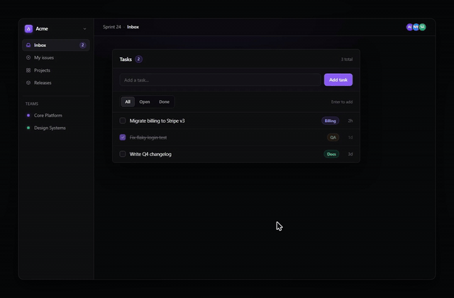

<div align="center">

<h1>PullReel</h1>

<p><strong>Turn your git diff into a cinematic, ScreenStudio-style demo GIF for your pull request — locally, in one command.</strong></p>

<p>Local-first · Ollama by default · no account · 60 fps MP4 + GitHub-ready GIF</p>

</div>

<table>
  <tr>
    <td width="50%" align="center">
      
      <br />
      <sub><strong>Raw headless capture</strong> — no cursor, no camera</sub>
    </td>
    <td width="50%" align="center">
      
      <br />
      <sub><strong>PullReel</strong> — 2x capture, spring camera, cursor, studio frame</sub>
    </td>
  </tr>
</table>

<p align="center">Full-quality 60 fps capture: <a href="docs/demo.mp4"><code>docs/demo.mp4</code></a></p>

## Try it in one command

<!-- `uvx pullreel` works once the package is published to PyPI -->

```bash
uvx pullreel demo
```

Or run from source:

```bash
git clone https://github.com/AYMRIKNG/pullreel && cd pullreel
uv run pullreel demo
```

`demo` records a bundled sample page with no LLM and no configuration. The first run downloads Chromium once; after that, a full run takes about 20 s on a laptop and writes `demo.mp4`, `demo.gif`, and `demo-poster.png` to `pullreel-out/`.

## Use it on your branch

Start your dev server, then from your project folder just run:

```bash
pullreel
```

The assistant asks which AI should direct (a local Ollama model, or a cloud provider with your API key — kept only if you say so, in your user settings, never in the repo), finds your running dev server, then analyzes the branch and lists **every interesting scenario**: the Scout's picks are starred and pre-checked, every other candidate stays selectable, and **✍ Write my own scenario…** lets you describe exactly what to show. Select several with the space bar and it films one video per scenario into `pullreel-out/` (`01-coaching.mp4`, `02-…`). If the app asks for a login, it offers to sign you in first.

```text
? Which scenarios should I film?  (space = select · a = all · enter = confirm)
 » ◉ ★ Coaching analytics  /coaching  — player combinations and match situations
   ◉ ★ Team defense  /statequipe  — new Analyse tab from opponent shots
   ○   StatJoueursPage  /statjoueurs  — Page Adversaires, gestion des joueurs
   ○   SettingPage  /settings  — fiche de match partageable et réglages
     ───────────
   ○ ✍  Write my own scenario…
```

Prefer flags (scripts, CI)? Everything is also available non-interactively:

```bash
pullreel record --url http://localhost:3000 --base main --out pr-demo.gif
```

1. **Diff** — inspects `merge-base(base, HEAD)` against your working tree (including uncommitted and untracked files), ignoring lockfiles and build artifacts, to extract changed routes, components, labels, test IDs, and handlers.
2. **Storyboard** — opens the app, captures Playwright's ARIA snapshot and visible interactive elements, and asks the LLM for a grounded 5–12 s storyboard focused on the delta.
3. **Human-paced recording** — drives headless Chromium at 2x Retina with curved mouse paths, natural typing cadence, CDP screencast capture, and 60 Hz telemetry.
4. **Cinematic render** — applies a spring camera, synthetic cursor, click ripples, and studio chassis, then encodes a 60 fps H.264 MP4 and an adaptive GitHub-ready GIF (< 10 MB, GitHub's limit), alongside `<stem>-poster.png` and `<stem>.storyboard.json`.

Drag `pr-demo.gif` (or the sharper `pr-demo.mp4` — GitHub plays it inline) into your PR description.

### Choosing what to film

Before writing any storyboard, a **Scout** step reads the project description (package.json, README), the commit messages and the *feature candidates* — changed files grouped by the page where they show up (file-based routes, React Router `<Route>` tables and their imports), scored by size, new files, new UI labels and commits. It picks the most demo-worthy, user-visible changes, then each storyboard is planned on **that feature's own page**.

```bash
pullreel record --url http://localhost:3000 --scenarios 3      # 3 features -> pr-demo-1.gif, pr-demo-2.gif, pr-demo-3.gif
pullreel record --url http://localhost:3000 --focus "global search"   # you choose the feature
pullreel diff --prompt                                            # see the candidates and commits the AI receives
pullreel record --url http://localhost:3000 --scenarios all --director composer   # every feature, no AI at all
```

### Stories, not click tours

Every scenario is directed as a short story that sells one feature: an establishing shot, a first use followed by a **`show` payoff** (the camera frames the table / chart / card that changed, the cursor points at it like a presenter), 2–4 **escalations** of the same feature, a **money shot** held longer, then a wide hold — 15–30 s, never wandering off to another page.

Two directors produce it, and the better film wins (`--director auto`, the default):

- **AI director** — writes a draft, rehearses it on the live app while observing what each click changed (*"a table 'On court' appeared, 2 → 4 → 8 rows"*), then rewrites the story with that knowledge.
- **Automatic composer** — explores the feature page by itself: finds groups of look-alike controls (player chips, filters, options, tabs — never the sidebar, never destructive buttons), clicks them one after another, keeps the group that drives a visible result and composes the escalating story from it. Deterministic, fast, no model needed (`--director composer`); also the safety net when an AI story is thin or fails.

Each rehearsed story gets a quality score (actions that change something, payoff shots, escalation, length, staying on the page); in `auto` mode a thin AI story is replaced by the composed one.

Want to review or tweak the shots before recording?

```bash
pullreel plan --url http://localhost:3000 --base main -o storyboard.json
# inspect or edit steps, zoom, dwell_after_ms
pullreel record --url http://localhost:3000 -s storyboard.json --out pr-demo.gif
```

### Apps behind a login

PullReel never types credentials, and stops with a clear message when it lands on a login form instead of letting a model invent a password. Sign in once, yourself:

```bash
pullreel login --url http://localhost:3000
```

A real browser window opens; sign in however you normally do (password, Google, SSO), then press Enter in the terminal or just close the window. PullReel saves only the resulting session — cookies, localStorage and IndexedDB — to `.pullreel/auth.json`, inside a folder that git-ignores itself. `record` and `plan` pick it up automatically (or pass `--auth FILE`). Delete the file to sign out; if the session expires, PullReel tells you to run `login` again.

## Commands

| Command | Purpose |
| --- | --- |
| `pullreel` (or `pullreel start`) | Interactive assistant: choose the AI, review every scenario, multi-select or write your own, film them. |
| `pullreel record --url URL` | Full pipeline: diff, plan (or `-s FILE`), record, render MP4/GIF, poster, and storyboard JSON. |
| `pullreel plan --url URL -o FILE` | Dry run: analyze the branch, ground the storyboard against the live page, write JSON. |
| `pullreel models` | List AI providers and whether each is ready (local server running, API key found). |
| `pullreel login --url URL` | Sign in once in a visible browser; saves only the session for `record` / `plan`. |
| `pullreel render DIR_OR_JSON` | Re-render a saved `--keep-frames` recording without launching a browser. |
| `pullreel diff [--base main]` | Inspect what PullReel extracted from the branch (`--prompt` prints the exact LLM input). |
| `pullreel demo [-o pullreel-out]` | Record and render the bundled demo page with no LLM or project setup. |

Passing `--out pr-demo.gif` writes both `pr-demo.mp4` and `pr-demo.gif`. Passing `--out pr-demo.mp4` writes only the MP4 unless `--gif` is set.

## Models

Set `--model` (or `PULLREEL_MODEL`) using a provider prefix. The default is `ollama/qwen2.5-coder:7b`; a bare model name (`llama3.2`) means Ollama. Run `pullreel models` to see which providers are ready on your machine (keys are detected, never displayed).

| Prefix | Default model | Key | Notes |
| --- | --- | --- | --- |
| `ollama/<model>` | `qwen2.5-coder:7b` | — | Default. Local; native `/api/chat` with the JSON schema as grammar-constrained output, 16k context, thinking off. |
| `lmstudio/<model>` | — | — | Local OpenAI-compatible server (`localhost:1234`). |
| `anthropic/<model>` | `claude-sonnet-5-5` | `ANTHROPIC_API_KEY` | Claude via the Messages API, answer forced through a tool with our schema. |
| `openai/<model>` | — | `OPENAI_API_KEY` | `json_schema` structured output. |
| `gemini/<model>` | — | `GEMINI_API_KEY` / `GOOGLE_API_KEY` | Google's OpenAI-compatible endpoint. |
| `mistral/<model>` | — | `MISTRAL_API_KEY` | |
| `deepseek/<model>` | — | `DEEPSEEK_API_KEY` | |
| `openrouter/<model>` | — | `OPENROUTER_API_KEY` | Hundreds of models behind one key. |
| `groq/<model>` | — | `GROQ_API_KEY` | Very fast inference. |

`--api-key` (or `PULLREEL_API_KEY`) overrides the key and `--base-url` (`PULLREEL_BASE_URL`) the endpoint. PullReel only reads keys from your environment and never writes them to disk. OpenAI-compatible endpoints get the strictest output format they accept (`json_schema`, then `json_object`, then plain text).

```bash
ANTHROPIC_API_KEY=sk-ant-... pullreel record --url http://localhost:3000 --model anthropic
PULLREEL_MODEL=ollama/qwen2.5-coder:7b pullreel plan --url http://localhost:3000
```

## How it works

```text
git diff ──> diff_analyzer ──> DiffSummary ──┐
                                             ├──> storyboard_agent (LLM) ──> Storyboard JSON
app URL  ──> Playwright ARIA snapshot ───────┘              ^                       │
                                                            │ error + live state    v
                                                            └─── rehearsal & grounding loop (<=3x)
                                                                                    │
  MP4 + GIF <── exporter (ffmpeg) <── cinema_engine <── human_runner <──────────────┘
                H.264 + <10 MB GIF    spring camera     Chromium 2x, CDP screencast,
                                      cursor, frame     60 Hz telemetry
```

| Module | Responsibility |
| --- | --- |
| `src/pullreel/diff_analyzer.py` | Git diff extraction, route inference (Next.js, SvelteKit, Nuxt, Remix, Astro, Django, FastAPI/Flask), UI symbol/label digest (capped at 6000 chars). |
| `src/pullreel/storyboard_agent.py` | Live ARIA snapshot, LLM prompt & structured output, normalization, Pydantic validation, pacing rules, and live rehearsal/grounding. |
| `src/pullreel/human_runner.py` | 2x Retina Chromium driver, CDP `Page.startScreencast`, Bézier mouse & typing simulation, 60 Hz telemetry. |
| `src/pullreel/cinema_engine.py` | Spring camera solver, 8x supersampled cursor sprite, click squash/ripple, and dark studio compositing. |
| `src/pullreel/exporter.py` | FFmpeg H.264 MP4 (`crf 18`, 60 fps, `faststart`), two-stage palette GIF under 10 MB, and PNG poster export. |
| `src/pullreel/models.py` | Pydantic contracts (`DiffSummary`, `Storyboard`, `Recording`, `StudioTheme`, `RenderSettings`). |
| `src/pullreel/cli.py` | Typer CLI (`record`, `plan`, `render`, `diff`, `demo`) and Rich progress output. |

## The craft

### Retina 2x capture
Chromium renders a `1280×800` viewport at `device_scale_factor=2` (`2560×1600`) and streams frames via CDP `Page.startScreencast` (JPEG q92, ~28 captures/s) instead of Playwright's blurry WebM recorder. Up to 2x zoom only ever downsamples with an area filter, so UI text stays sharp.

### Minimum-jerk Bezier mouse
Pointer paths follow cubic Bézier curves with random perpendicular curvature, Fitts-like travel times (0.35–1.1 s), and the minimum-jerk law `s(t) = 10t³ − 15t⁴ + 6t⁵`. Real `mouse.move` events fire hover states, clicks hold 70–110 ms, typing runs 35–75 ms/char, and the trajectory is stored analytically at 60 Hz.

### Critically damped spring camera
Camera `(x, y, zoom)` integrates `a = ω²(target − x) − 2ζω·v` (`ω = 6.5` rad/s, `ζ = 1`, semi-implicit Euler with 4 substeps) while reading telemetry 250 ms ahead so zooms anticipate clicks. Focus shots blend 80% element centre + 20% cursor, pan mode uses a 30% deadzone, and every crop stays clamped inside `2560×1600`.

### Synthetic cursor, click ripple, and studio frame
Headless Chromium draws no pointer, so PullReel composites an 8x supersampled arrow with white outline, soft shadow, sub-pixel placement, 0.88 press squash, and a 250 ms fading click ripple. The frame sits on a `#09090B` backdrop with faint centre light, drop shadow, 16 px rounded corners, 1 px `#27272A` border, and 56 px padding (`1392×912` output).

## Zero hallucinated selectors

PullReel directs the LLM to target only semantic locators (`role` + `name`, `label`, `placeholder`, `text`, `testid`; `css` is discouraged) drawn from the live ARIA snapshot. After normalizing small-model slips, validating with Pydantic, and enforcing pacing guardrails (400 ms wide opening, `fill` always in focus, focus zoom 1.3–1.9x, 1 s closing hold, ≤ 12 s total), it rehearses the entire storyboard at full speed in a fresh browser. Every locator must resolve at the exact moment it runs — including elements created by earlier steps. Misses are fuzzy-repaired against live elements; unresolved errors and current page state are sent back to the model for up to 3 attempts.

## Storyboard format

```json
{
  "feature_summary": "Filter issues and export the filtered view to CSV",
  "start_path": "/issues",
  "steps": [
    {
      "action": "wait",
      "camera": { "mode": "wide", "zoom": 1.0 },
      "dwell_after_ms": 400
    },
    {
      "action": "fill",
      "locator": { "strategy": "placeholder", "value": "Search issues..." },
      "input_value": "billing export",
      "camera": { "mode": "focus", "zoom": 1.75 },
      "dwell_after_ms": 450
    },
    {
      "action": "click",
      "locator": { "strategy": "role", "value": "button", "name": "Export CSV" },
      "camera": { "mode": "focus", "zoom": 1.5 },
      "dwell_after_ms": 600
    },
    {
      "action": "wait",
      "camera": { "mode": "wide", "zoom": 1.0 },
      "dwell_after_ms": 1000
    }
  ]
}
```

## Requirements & troubleshooting

<details>
<summary>Environment, proxies, Ollama, GPU sizing, and timings</summary>

- **Runtime**: Python 3.12+ and [`uv`](https://docs.astral.sh/uv/).
- **FFmpeg**: Optional. PullReel uses `ffmpeg` from `PATH` if present, otherwise falls back to the static binary bundled by `imageio-ffmpeg`.
- **Chromium**: Installed automatically by Playwright on the first run.
- **Corporate TLS proxy** (`invalid peer certificate: UnknownIssuer`): pass `--system-certs` to `uv`, e.g. `uv sync --system-certs`.
- **Ollama not running**: Start the daemon with `ollama serve`.
- **Model not pulled**: Run `ollama pull qwen2.5-coder:7b` (or pull whichever model you pass to `--model`).
- **Small GPU (e.g. 4 GB VRAM)**: Stick to 7B models. On a 4 GB laptop GPU, local 26B models took 50–175 s just to plan; 7B models are substantially faster.
- **Typical timings & sizes**: `pullreel demo` runs in about 20 s on a laptop (~1 MB for a 6.7 s 60 fps MP4, ~4.7 MB GIF). GIF export starts at 960 px / 30 fps and adapts width (down to 720 px) then fps to stay under 9.5 MB (GitHub accepts GIFs up to 10 MB).

</details>

## Roadmap

Planned next, not yet implemented:

- GitHub Action that comments the rendered demo GIF directly on pull requests
- Additional studio themes (including a light studio backdrop)
- Multi-page navigation flows

## Contributing

```bash
uv sync
uv run pytest
```

74 tests cover the diff analyzer (including real temporary git repos), the storyboard agent and AI providers, the automatic composer, login handling, the interactive assistant and the CLI helpers.

To regenerate the README comparison GIFs:

```bash
uv run pullreel demo --out docs --keep-frames
uv run python scripts/make_readme_gifs.py <kept-frames-dir> docs
```

## License

MIT
