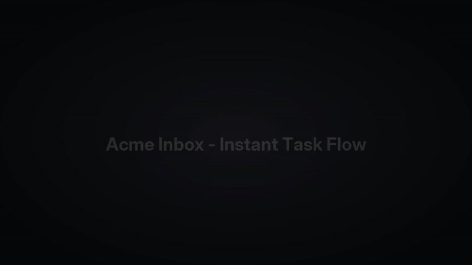
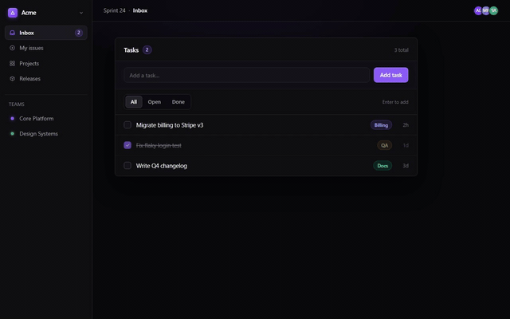

<div align="center">

<h1>PullReel</h1>

<p><strong>Turn your git diff into a studio-grade, ScreenStudio-style demo video for pull requests, landing pages, release notes, and social media — locally, in one command.</strong></p>

<p>Local-first · Ollama or Cloud AI · 60 fps MP4 / WebM / animated WebP / GIF · Smart 16:9 / 1:1 / 9:16 / 4:5 reframing · <code>pullreel.toml</code> branding</p>

<a href="docs/showcase.mp4"></a>

<sub>Made by PullReel itself with <code>pullreel demo --aspect 16:9 --quality ultra --url-bar --intro --outro</code> · <a href="docs/showcase.mp4">watch the 60 fps MP4</a></sub>

</div>

<table>
  <tr>
    <td width="50%" align="center">
      
      <br />
      <sub><strong>Raw headless capture</strong> — no cursor, no camera</sub>
    </td>
    <td width="50%" align="center">
      
      <br />
      <sub><strong>PullReel</strong> — 2x capture, spring camera, vector cursor, studio frame</sub>
    </td>
  </tr>
</table>

<p align="center">Full-quality 60 fps capture: <a href="docs/demo.mp4"><code>docs/demo.mp4</code></a></p>

## Try it in one command

```bash
pullreel demo --aspect 16:9 --quality ultra
```

Or run from source:

```bash
git clone https://github.com/AYMRIKNG/pullreel && cd pullreel
uv run pullreel demo --aspect 16:9 --quality ultra
```

`demo` records a bundled sample page with no LLM and no configuration. The first run downloads Chromium once; after that, a run writes `demo.mp4`, `demo.gif`, and the money-shot `demo-poster.png` to `pullreel-out/` (plus `.webp`, `.webm`, and an annotated `-screenshots.png` sheet when enabled).

## Use it on your branch

Start your dev server, then from your project folder just run:

```bash
pullreel
```

The assistant asks which AI should direct (a local Ollama model, or a cloud provider with your API key), finds your running dev server, analyzes the branch, ranks every scenario by **sales value**, and flags any scenario that modifies app state (`[mutates]`). Select several with the space bar or choose **Write my own scenario…** — PullReel always respects your custom request and never silently replaces it with another demo.

```text
? Which scenarios should I film?  (space = select · a = all · enter = confirm)
 » ◉ ★ Add a new player to Roster  /roster  [score 86 · mutates]  — new creation modal
   ◉ ★ Coaching analytics  /coaching  [score 78]  — player combinations and match situations
   ○   Team defense  /statequipe  [score 71]  — new Analyse tab from opponent shots
     ───────────
   ○ ✍  Write my own scenario…
```

Prefer flags (scripts, CI)? Everything is available non-interactively:

```bash
pullreel record --url http://localhost:3000 --base main --aspect 16:9 --resolution 1080p --quality standard --out pr-demo.gif
```

## Studio rendering & formats

PullReel renders production-ready visuals directly from 2x Retina (`2560×1600`) CDP screencasts through a parallel, zero-disk-PNG pipeline piped straight into FFmpeg:

- **Polished studio chassis**: solid colors, angled gradients, built-in presets (`studio`, `midnight`, `aurora`, `sunset`, `ocean`, `carbon`, `light`), or a Gaussian-blurred custom wallpaper; **macOS**, **Windows**, or **none** window chrome; adjustable corner radius, soft drop shadow, padding, and an optional browser URL bar (`--url-bar`).
- **Cinematic spring camera**: critically damped spring (`ω=6.5, ζ=1`) with lookahead anticipation, smoothed transitions between focus boxes, zoom-dip on long pans, generous focus padding so zoomed elements are never clipped, and speed-proportional temporal motion blur.
- **High-resolution vector cursors**: 8x supersampled **arrow**, **pointing hand**, and **I-beam** cursors automatically matched to the target element, with press squash (`0.90`), soft drop shadow, fast-movement motion trail, and dual-ring click ripples.
- **Animated text overlays** (bundled **Inter** variable font under SIL OFL 1.1): ease-out **intro title cards** (`--intro`), **outro CTA cards** (`--outro`), per-step **captions** (`caption` on each `ActionStep`), and a bottom-right **keystroke HUD** during typing and shortcuts.
- **Smart reframing**: `--aspect 16:9|1:1|9:16|4:5` dynamically crops and tracks the `focus_box` and cursor without stretching or letterboxing.
- **Money-shot poster & doc screenshots**: automatically selects the sharpest settled focus/payoff frame for `<stem>-poster.png`, and `--screenshots` generates an annotated contact sheet (`<stem>-screenshots.png`) plus individual step PNGs with highlight rings for documentation.

### Formats & resolutions

| Format / Asset | Flag / Config | Codec / Details | Best for |
| --- | --- | --- | --- |
| **MP4** | default (`mp4`) | H.264 `yuv420p`, `+faststart` | GitHub PRs, landing pages, Product Hunt, X/LinkedIn |
| **WebM** | `--webm` or `--formats mp4,webm` | VP9 (`libvpx-vp9`, `-b:v 0 -row-mt 1`) | Lightweight web embeds |
| **Animated WebP** | `--webp` or `--formats mp4,webp` | `libwebp_anim`, 24-bit color, looping | Release notes, docs, changelogs |
| **GIF** | `--gif` / `--out demo.gif` | Adaptive 2-pass palette (`< 9.5 MB`) | GitHub PR comments |
| **Poster PNG** | automatic (`<stem>-poster.png`) | Best money-shot frame | Video thumbnails & social cards |
| **Screenshots sheet** | `--screenshots` | Annotated contact sheet + per-step PNGs | Product docs & step-by-step guides |

| `--resolution` | `16:9` | `1:1` | `9:16` | `4:5` |
| --- | --- | --- | --- | --- |
| `1080p` | `1920×1080` | `1080×1080` | `1080×1920` | `1080×1350` |
| `1440p` | `2560×1440` | `1440×1440` | `1440×2560` | `1440×1800` |
| `4k` | `3840×2160` | `2160×2160` | `2160×3840` | `2160×2700` |

### Quality presets (`--quality`)

| Preset | FPS | CRF | Motion blur | x264 preset | Notes |
| --- | --- | --- | --- | --- | --- |
| `draft` | 30 | 24 | Off (`0.0`) | `veryfast` | Fast previews, scaled down for rapid iteration |
| `standard` | 60 | 18 | Medium (`0.35`) | `medium` | Default balanced quality & speed |
| `ultra` | 60 | 15 | Rich (`0.50`, 3 subframes) | `slow` | Maximum crispness for launches & landing pages |

## Branding with `pullreel.toml`

Place a `pullreel.toml` at the root of your target repository (or pass `--config FILE`). PullReel loads and validates it with Pydantic automatically; CLI flags always override `pullreel.toml`.

```toml
[brand]
name = "Acme"
primary_color = "#09090B"
accent_color = "#8B5CF6"
logo = "assets/logo.png"          # optional PNG/SVG-rendered raster logo
# font = "assets/CustomFont.ttf"  # optional; defaults to bundled Inter (OFL)

[theme]
background_preset = "midnight"    # studio | midnight | aurora | sunset | ocean | carbon | light
# background_style = "wallpaper"  # studio | solid | gradient | wallpaper
# wallpaper = "assets/bg.jpg"
# wallpaper_blur = 36
window_chrome = "macos"           # macos | windows | none
show_url_bar = true
radius_px = 16
padding_px = 56
shadow_blur = 48
shadow_alpha = 0.55
show_captions = true
show_keystrokes = true

[intro]
enabled = true
title = "Acme Inbox"
subtitle = "Triage issues in half the time"
duration_s = 1.6

[outro]
enabled = true
title = "Built with Acme"
cta = "acme.dev"
duration_s = 1.6

[render]
aspect = "16:9"                   # 16:9 | 1:1 | 9:16 | 4:5
resolution = "1080p"              # native | 1080p | 1440p | 4k
quality = "standard"              # draft | standard | ultra
formats = ["mp4", "gif", "webp"]  # mp4 | webm | gif | webp
screenshots = true

[safety]
dry_rehearsal = false
extra_blocklist = ["purge", "archive"]
```

## Concrete user journeys & safety

PullReel directs real business journeys instead of random click tours:

- **Workflow detection**: automatically detects entity creation (`+ Add…`, `New…`, `Create…` modals/forms), editing, search/filter, comparison, export/import, and settings flows, giving each a clear business title (*"Add a new player in Team Roster"*, not *"Click Add"*).
- **Realistic, safe form filling**: generates domain-coherent names, numbers (within `min`/`max`), dates, and `<select>` choices from field metadata. Emails always use `@example.com`; password, card, CVV, IBAN, and API-key fields are strictly refused.
- **Multi-page journeys**: storyboards with `"journey": true` can span 2–3 pages (e.g. list → detail → list) without being treated as navigation errors.
- **Mutation safety**: mutating scenarios are flagged (`mutates: true`), display a yellow warning before recording, enforce an extended destructive-action blocklist (delete, remove, reset, revoke, sign out, deactivate, etc.), and support `--dry-rehearsal` (rehearses the entire form flow and verifies the submit button without clicking submit).
- **User intent respected**: when you pass `--focus "..."` or pick **Write my own scenario…**, PullReel strictly follows your request and never substitutes an unrelated auto-composed demo if the AI fails.

## Commands

| Command | Purpose |
| --- | --- |
| `pullreel` (or `pullreel start`) | Interactive assistant: choose AI, review sales-ranked scenarios, multi-select or write your own, film them. |
| `pullreel record --url URL` | Full pipeline: diff, plan (or `-s FILE`), record, render MP4/WebM/WebP/GIF, poster, screenshots, storyboard JSON. |
| `pullreel plan --url URL -o FILE` | Dry run: analyze the branch, ground the storyboard against the live page (supports `--dry-rehearsal`), write JSON. |
| `pullreel render DIR_OR_JSON` | Re-render a saved `--keep-frames` recording with new aspect/resolution/quality/theme settings without launching a browser. |
| `pullreel models` | List AI providers and whether each is ready (local server running, API key found). |
| `pullreel login --url URL` | Sign in once in a visible browser; saves only the session for `record` / `plan`. |
| `pullreel diff [--base main]` | Inspect what PullReel extracted from the branch (`--prompt` prints the exact LLM input). |
| `pullreel demo [-o pullreel-out]` | Record and render the bundled demo page with no LLM or project setup. |

Add `--verbose` / `-v` for debug logging or `--log-file pullreel.jsonl` for structured JSONL logs (API keys and bearer tokens are automatically redacted).

## Models

Set `--model` (or `PULLREEL_MODEL`) using a provider prefix. The default is `ollama/qwen2.5-coder:7b`; a bare model name (`llama3.2`) means Ollama. Run `pullreel models` to see which providers are ready on your machine.

| Prefix | Default model | Key | Notes |
| --- | --- | --- | --- |
| `ollama/<model>` | `qwen2.5-coder:7b` | — | Default. Local; native `/api/chat` with grammar-constrained JSON schema. |
| `lmstudio/<model>` | — | — | Local OpenAI-compatible server (`localhost:1234`). |
| `anthropic/<model>` | `claude-sonnet-5-5` | `ANTHROPIC_API_KEY` | Claude via the Messages API with forced tool-use JSON. |
| `openai/<model>` | — | `OPENAI_API_KEY` | `json_schema` structured output. |
| `gemini/<model>` | — | `GEMINI_API_KEY` / `GOOGLE_API_KEY` | Google's OpenAI-compatible endpoint. |
| `mistral/<model>` | — | `MISTRAL_API_KEY` | |
| `deepseek/<model>` | — | `DEEPSEEK_API_KEY` | |
| `openrouter/<model>` | — | `OPENROUTER_API_KEY` | Hundreds of models behind one key. |
| `groq/<model>` | — | `GROQ_API_KEY` | Very fast inference. |

## Storyboard format

```json
{
  "feature_summary": "Add a new player to the roster and inspect their row",
  "start_path": "/roster",
  "journey": false,
  "mutates": true,
  "steps": [
    {
      "action": "wait",
      "camera": { "mode": "wide", "zoom": 1.0 },
      "dwell_after_ms": 800
    },
    {
      "action": "click",
      "locator": { "strategy": "role", "value": "button", "name": "+ Add player" },
      "camera": { "mode": "focus", "zoom": 1.65 },
      "dwell_after_ms": 600,
      "caption": "Open the new player dialog"
    },
    {
      "action": "fill",
      "locator": { "strategy": "label", "value": "Player name" },
      "input_value": "Alex Moreau",
      "camera": { "mode": "focus", "zoom": 1.75 },
      "dwell_after_ms": 500,
      "caption": "Enter player details"
    },
    {
      "action": "click",
      "locator": { "strategy": "role", "value": "button", "name": "Save player" },
      "camera": { "mode": "focus", "zoom": 1.6 },
      "dwell_after_ms": 900,
      "caption": "Save to the live roster"
    },
    {
      "action": "show",
      "locator": { "strategy": "text", "value": "Alex Moreau" },
      "camera": { "mode": "focus", "zoom": 1.45 },
      "dwell_after_ms": 1800,
      "caption": "New player appears immediately"
    },
    {
      "action": "wait",
      "camera": { "mode": "wide", "zoom": 1.0 },
      "dwell_after_ms": 1400
    }
  ]
}
```

## Contributing

```bash
uv sync
uv run pytest -q
```

All tests run locally with zero network access (synthetic recordings and local HTML pages).

## License

MIT (bundled Inter font under SIL Open Font License 1.1; see `src/pullreel/assets/fonts/OFL.txt`).
